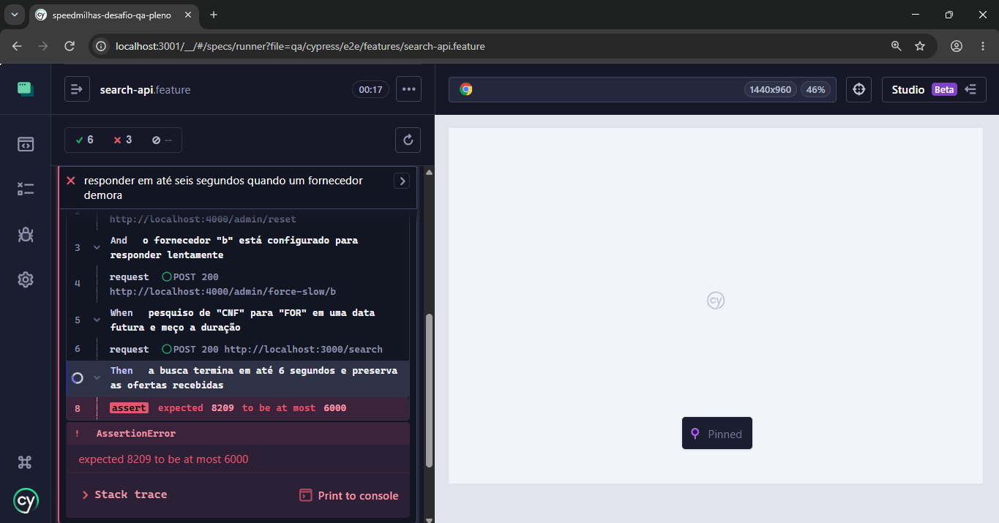
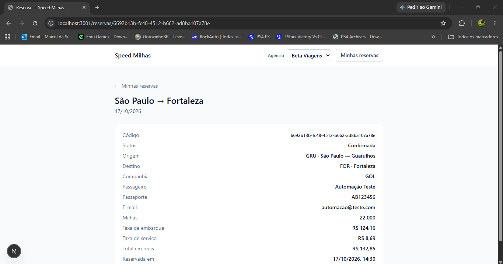
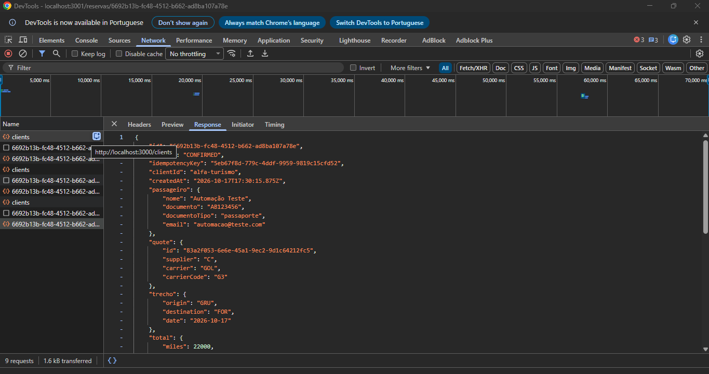

# Bugs encontrados

<!-- Copie o bloco abaixo para cada bug. Gravidade: crítica, alta, média ou baixa. -->

## BUG-01 — tela de "detalhes" da reservas não atualiza ao trocar de agência

- **Onde:** tela
- **Gravidade:** Gravissimo
- **Regra da SPEC:** 16

**Passos para reproduzir**

1.Realizar a reserva de uma passagem com sucesso
2.clicar no botão "Minhas reservas"
3.clicar no botão "Ver detalhes" da reserva 
4.ao exibir os detalhes da reserva, trocar de agência

**Resultado esperado**
A tela deveria atualizar, deixando de exibir os detalhes da reserva
**Resultado obtido**
A tela não carrega, mantendo a exibição da reserva de outra agência
**Evidência**

## BUG-02 — Tempo de resposta de retorno da API

- **Onde:** API
- **Gravidade:** Grave
- **Regra da SPEC:** 6

**Passos para reproduzir**
1.pesquisar de "FOR" para "GIG" em uma data futura

**Resultado esperado**
O tempo de retorno das informações deveria ser menor ou igual a 6 segundos
**Resultado obtido**
tempo de retorno superior a 8 segundos
**Evidência**
